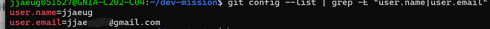

# codysseyE1-1

## 1. GitHub Repository + README.md
- GitHub 저장소 생성 및 README.md 작성
- git init, git remote add, git push 완료

## 2. 터미널 기본 명령어
- `pwd` : 현재 경로 확인
- `ls` : 파일 목록 확인
- `mkdir` : 디렉토리 생성
- `echo` : 텍스트 출력
- `cat` : 파일 내용 확인

## 3. 파일 권한 실습 (chmod)

### 권한 숫자 의미
| 숫자 | 권한 | 의미 |
|------|------|------|
| 4 | r | 읽기 |
| 2 | w | 쓰기 |
| 1 | x | 실행 |
| 7 | rwx | 읽기+쓰기+실행 |
| 5 | r-x | 읽기+실행 |
| 0 | --- | 권한 없음 |

### 실습 명령어
- `ls -l` : 파일 권한 확인
- `chmod 755 permission-test.txt` : 소유자 rwx, 그룹/others r-x
- `chmod 700 permission-dir` : 소유자만 rwx, 나머지 접근 불가

## 4. Docker 설치 확인
- `docker version` : Docker 버전 확인
- `docker info` : Docker 시스템 정보 확인

## 5. Docker 기본 운영 명령
- `docker images` : 이미지 목록 확인
- `docker ps` : 실행 중인 컨테이너 확인
- `docker logs test-nginx` : 컨테이너 로그 확인
- `docker stats --no-stream` : 리소스 사용량 확인

## 6. 컨테이너 실행
- `docker run hello-world` : hello-world 컨테이너 실행
- `docker run -it ubuntu bash` : ubuntu 컨테이너 실행

## 7. Dockerfile 빌드 및 실행
- `docker build -t my-ubuntu .` : Dockerfile로 이미지 빌드
- `docker run my-ubuntu` : 커스텀 이미지 실행

### 작성한 Dockerfile
` ` `dockerfile
FROM ubuntu:22.04
RUN apt-get update && apt-get install -y curl
CMD ["bash"]
` ` `

## 8. 바인드 마운트 실습
- 호스트 디렉토리를 컨테이너에 직접 연결

### 실행 명령어
` ` `bash
docker run -d \
  --name bind-nginx \
  -p 8090:80 \
  -v ~/dev-mission/bind-test:/usr/share/nginx/html \
  nginx
` ` `

### 결과
- 최초 접속 → `<h1>Hello from Host!</h1>` 확인
- 파일 수정 후 → `<h1>Hello, Changed!</h1>` 즉시 반영
- 컨테이너 재시작 없이 변경사항 반영 ✅

## 9. Docker 볼륨 (Volume) 실습 
- `docker volume create mydata` : 볼륨 생성
- `docker run -v mydata:/data ubuntu` : 볼륨 연결
