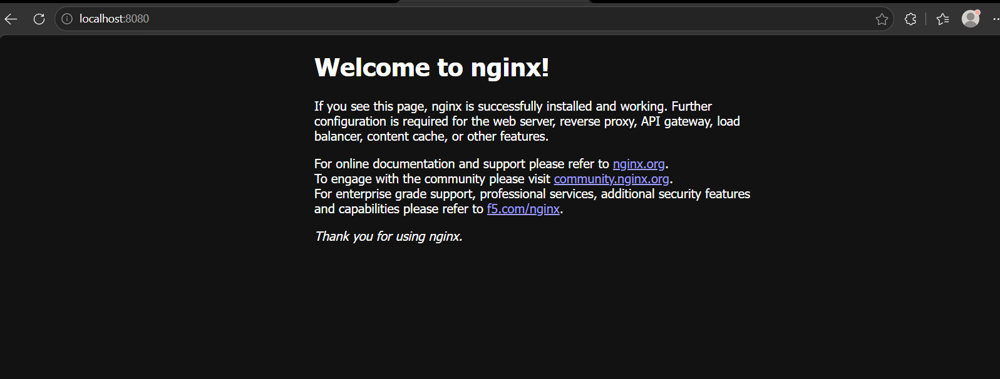
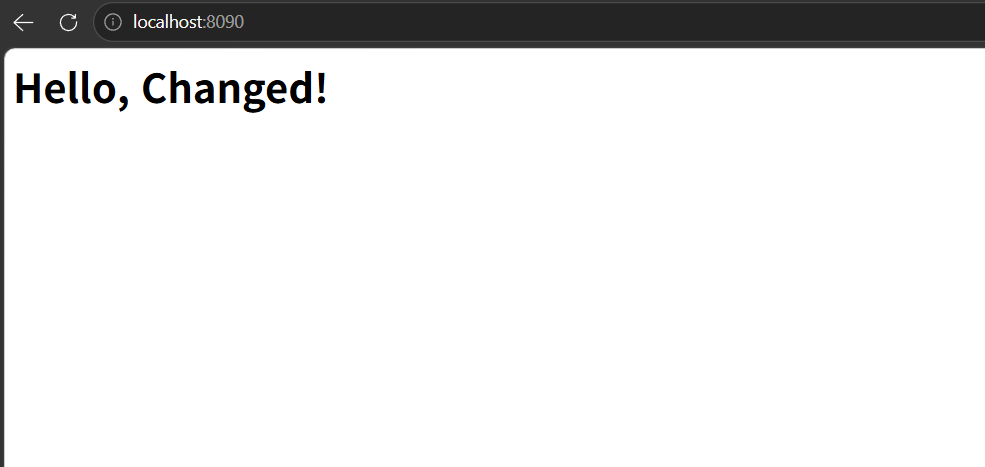
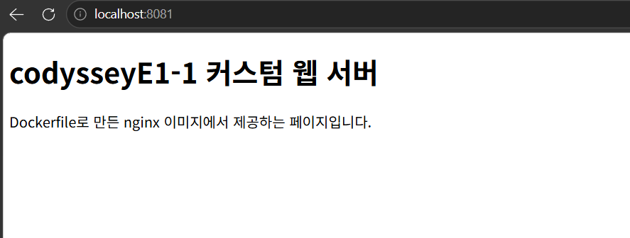
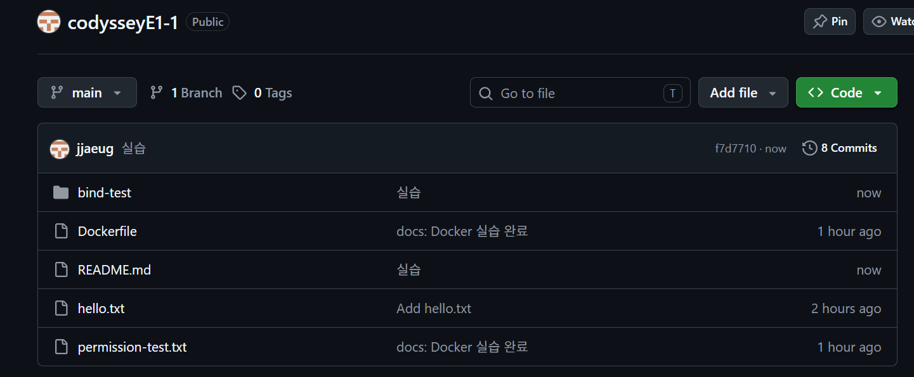
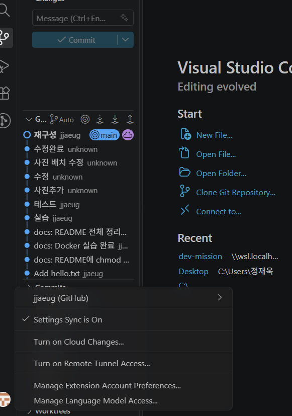

# codysseyE1-1 — 개발 워크스테이션 구축

터미널, Docker, Git을 직접 세팅하고 **실행 결과(로그·접속·데이터 유지)로 동작을 검증**한 기록입니다.
이 문서만 읽어도 전체 수행 내용과 증거를 확인할 수 있도록 정리했습니다.

* 저장소: https://github.com/jjaeug/codysseyE1-1
* 스크린샷: [`p/`](p/) 폴더 (브라우저 접속, GitHub, VSCode 화면)
* 터미널 증거: 각 절의 코드블록 (명령어 + 출력)

## 목차

1. [미션 개요](#1-미션-개요)
2. [실행 환경](#2-실행-환경)
3. [수행 체크리스트](#3-수행-체크리스트)
4. [검증 방법 요약](#4-검증-방법-요약)
5. [터미널 기본 조작](#5-터미널-기본-조작)
6. [파일 권한 실습](#6-파일-권한-실습)
7. [Docker 설치 및 점검](#7-docker-설치-및-점검)
8. [Docker 기본 운영 명령](#8-docker-기본-운영-명령)
9. [컨테이너 실행 실습](#9-컨테이너-실행-실습)
10. [Dockerfile 커스텀 이미지](#10-dockerfile-커스텀-이미지)
11. [포트 매핑](#11-포트-매핑)
12. [바인드 마운트](#12-바인드-마운트)
13. [Docker 볼륨 영속성](#13-docker-볼륨-영속성)
14. [Git 설정 및 GitHub 연동](#14-git-설정-및-github-연동)
15. [보안 및 개인정보 보호](#15-보안-및-개인정보-보호)
16. [트러블슈팅](#16-트러블슈팅)
17. [저장소 구성 및 재현 방법](#17-저장소-구성-및-재현-방법)

---

## 1. 미션 개요

* **목표**: 코드가 "내 컴퓨터에서만" 돌아가는 문제를 줄이기 위해, 누구나 같은 방식으로 실행·배포·디버깅할 수 있는 개발 환경을 직접 구성한다.
* **사용 도구**: 리눅스 CLI(터미널), Docker(컨테이너), Git/GitHub(버전 관리·협업)
* **수행 범위**

  1. 터미널로 작업 디렉토리를 만들고 파일·권한을 다룬다.
  2. Docker를 설치·점검하고 컨테이너를 실행·관리한다(이미지, 로그, 리소스).
  3. Dockerfile로 커스텀 이미지(ubuntu 기반 도구 이미지, nginx 기반 웹 서버 이미지)를 만들고, 포트 매핑으로 접속을 확인한다.
  4. 바인드 마운트로 "변경 반영", 볼륨으로 "데이터 영속성"을 검증한다.
  5. Git 설정 후 GitHub 저장소와 연동한다.

## 2. 실행 환경

|항목|값|
|-|-|
|OS|Ubuntu 24.04.4 LTS (Windows WSL2, 커널 `6.6.87.2-microsoft-standard-WSL2`)|
|Shell|bash|
|Terminal|WSL Ubuntu 터미널|
|Docker|Docker Engine 29.1.3 (`docker.io` 패키지, WSL 내부 설치)|
|Git|2.43.0|
|메모리|PC 3.4GB / WSL 할당 약 1.5GB|
|작업 디렉토리|`~/dev-mission` (= `/home/jjw/dev-mission`)|

환경 확인 명령:

```bash
cat /etc/os-release | head -2
uname -r
echo $SHELL
docker --version
git --version
```

```text
$ cat /etc/os-release | head -2; uname -r; echo $SHELL; docker --version; git --version
PRETTY_NAME="Ubuntu 24.04.4 LTS"
NAME="Ubuntu"
6.6.87.2-microsoft-standard-WSL2
/bin/bash
Docker version 29.1.3, build 29.1.3-0ubuntu3~24.04.2
git version 2.43.0
```

> **개인 PC 종속 주의**
> - `~/dev-mission`은 제 WSL 홈 디렉토리 기준 경로입니다. 다른 환경에서는 이 저장소를 clone한 폴더에서 실행하고, 경로가 필요한 곳은 `$(pwd)`로 바꿔 쓰면 됩니다.
> - Windows에서는 `/mnt/c/...`(Windows 드라이브)가 아니라 **WSL 홈(`~`) 아래**에서 작업해야 합니다. 기본 설정에서는 Windows 드라이브의 파일에 `chmod`가 반영되지 않습니다.
> - 자세한 재현 절차는 [17절](#17-저장소-구성-및-재현-방법) 참고

## 3. 수행 체크리스트

- [x] 터미널 기본 조작 및 폴더 구성
- [x] 권한 변경 실습 (파일 1개, 디렉토리 1개)
- [x] Docker 설치 및 점검
- [x] Docker 기본 운영 명령 (`images` / `ps` / `logs` / `stats`)
- [x] `hello-world` 실행
- [x] `ubuntu` 컨테이너 진입 후 명령 실행
- [x] 컨테이너 종료/유지 (attach / exec) 차이 관찰
- [x] Dockerfile 커스텀 이미지 빌드 및 실행 (`my-ubuntu`)
- [x] Dockerfile 기반 웹 서버 이미지 빌드 및 실행 (`my-web`: nginx + `web/app/` 소스)
- [x] 포트 매핑 접속 (8080, 8090, 8081 — 3회)
- [x] 바인드 마운트 변경 반영
- [x] 볼륨 영속성 검증
- [x] Git 사용자 정보·기본 브랜치 설정 + GitHub 저장소 연동
- [x] VSCode GitHub 로그인 및 저장소 연동

## 4. 검증 방법 요약

|항목|확인 명령|확인 기준|증거|
|-|-|-|-|
|터미널 조작|`pwd`, `ls -la`, `mkdir`, `cp`, `mv`, `rm`, `cat`, `touch`|생성·복사·이동·삭제가 `ls` 결과에 반영됨|[5절](#5-터미널-기본-조작)|
|권한|`ls -l`, `chmod 755`, `chmod 700`|변경 전/후 권한 문자열이 달라짐|[6절](#6-파일-권한-실습)|
|Docker 점검|`docker --version`, `docker info`|버전 출력, `Server Version` 표시(데몬 동작)|[7절](#7-docker-설치-및-점검)|
|운영 명령|`docker images`, `docker ps -a`, `docker logs`, `docker stats`|이미지·컨테이너 목록, 접속 로그, CPU/메모리 사용량|[8절](#8-docker-기본-운영-명령)|
|hello-world|`docker run hello-world`|`Hello from Docker!` 출력|[9절](#9-컨테이너-실행-실습)|
|커스텀 이미지|`docker build -t my-ubuntu .`, `docker build -t my-web:1.0 web/`, `docker run ...`|빌드 성공, CMD 메시지 출력, 웹 페이지 응답, `(healthy)` 상태|[10절](#10-dockerfile-커스텀-이미지)|
|포트 매핑|`docker run -p 8080:80 ...`, 브라우저/`curl` 접속|`localhost:8080`, `localhost:8090`, `localhost:8081`에서 응답|[11절](#11-포트-매핑), [p/browser-8080.png](p/browser-8080.png), [p/browser-8090.png](p/browser-8090.png), [p/browser-8081.png](p/browser-8081.png)|
|바인드 마운트|`docker run -v $(pwd)/bind-test:...`, `curl localhost:8090`|호스트 파일 수정이 재시작 없이 반영|[12절](#12-바인드-마운트)|
|볼륨|`docker volume create`, 컨테이너 삭제 후 재연결|새 컨테이너에서 기존 데이터 확인|[13절](#13-docker-볼륨-영속성)|
|Git|`git config --list`, `git remote -v`|`user.name`, `user.email`, `init.defaultBranch` 설정, 원격 저장소 연결|[14절](#14-git-설정-및-github-연동), [p/2.png](p/2.png), [p/vscode-github.png](p/vscode-github.png)|

---

## 5. 터미널 기본 조작

### 개념: 절대 경로 vs 상대 경로

|구분|기준|예시|
|-|-|-|
|절대 경로|루트 `/`부터 전체 위치를 적음. 현재 위치와 상관없이 항상 같은 곳을 가리킴|`/home/jjw/dev-mission/hello.txt`|
|상대 경로|**현재 위치(`pwd`)** 기준. `.`은 현재 폴더, `..`은 상위 폴더|`./hello.txt`, `../dev-mission/hello.txt`|

예: `~/dev-mission`에 있을 때 `cat hello.txt`와 `cat /home/jjw/dev-mission/hello.txt`는 같은 파일을 읽지만, `cd /tmp`로 이동하면 상대 경로 `hello.txt`는 찾을 수 없습니다.

### 실행 명령

```bash
pwd                                  # 현재 위치 확인
ls -la                               # 목록 확인 (숨김 파일 포함)
mkdir -p practice/sub                # 디렉토리 생성
cd practice                          # 이동
pwd
touch empty.txt                      # 빈 파일 생성
ls -l empty.txt                      # 크기 0 확인
echo "Hello, Terminal!" > hello.txt  # 내용 있는 파일 생성
cat hello.txt                        # 파일 내용 확인
cp hello.txt hello-copy.txt          # 복사
mv hello-copy.txt renamed.txt        # 이름 변경
mv renamed.txt sub/                  # 이동
ls -la sub/
rm sub/renamed.txt                   # 파일 삭제
rm -r sub                            # 디렉토리 삭제
ls -la
cd ..
```

```text
jjw@DESKTOP-I2K2FML:~/dev-mission$ pwd
/home/jjw/dev-mission
jjw@DESKTOP-I2K2FML:~/dev-mission$ ls -la
total 64
drwxr-xr-x 5 jjw jjw  4096 Nov  4 23:43 .
drwxr-x--- 6 jjw jjw  4096 Nov  4 23:43 ..
drwxr-xr-x 8 jjw jjw  4096 Nov  4 23:43 .git
-rw-r--r-- 1 jjw jjw   107 Nov  4 23:13 Dockerfile
-rw-r--r-- 1 jjw jjw 33856 Nov  5 00:54 README.md
drwxr-xr-x 2 jjw jjw  4096 Nov  4 23:13 bind-test
-rw-r--r-- 1 jjw jjw    34 Nov  4 23:13 hello.txt
drwxr-xr-x 2 jjw jjw  4096 Nov  5 00:35 p
-rwxr-xr-x 1 jjw jjw     0 Nov  4 23:13 permission-test.txt
jjw@DESKTOP-I2K2FML:~/dev-mission$ mkdir -p practice/sub
jjw@DESKTOP-I2K2FML:~/dev-mission$ cd practice
jjw@DESKTOP-I2K2FML:~/dev-mission/practice$ pwd
/home/jjw/dev-mission/practice
jjw@DESKTOP-I2K2FML:~/dev-mission/practice$ touch empty.txt
jjw@DESKTOP-I2K2FML:~/dev-mission/practice$ ls -l empty.txt
-rw-r--r-- 1 jjw jjw 0 Nov  5 00:57 empty.txt
jjw@DESKTOP-I2K2FML:~/dev-mission/practice$ echo "Hello, Terminal!" > hello.txt
jjw@DESKTOP-I2K2FML:~/dev-mission/practice$ cat hello.txt
Hello, Terminal!
jjw@DESKTOP-I2K2FML:~/dev-mission/practice$ cp hello.txt hello-copy.txt
jjw@DESKTOP-I2K2FML:~/dev-mission/practice$ mv hello-copy.txt renamed.txt
jjw@DESKTOP-I2K2FML:~/dev-mission/practice$ mv renamed.txt sub/
jjw@DESKTOP-I2K2FML:~/dev-mission/practice$ ls -la sub/
total 12
drwxr-xr-x 2 jjw jjw 4096 Nov  5 00:58 .
drwxr-xr-x 3 jjw jjw 4096 Nov  5 00:58 ..
-rw-r--r-- 1 jjw jjw   17 Nov  5 00:58 renamed.txt
jjw@DESKTOP-I2K2FML:~/dev-mission/practice$ rm sub/renamed.txt
jjw@DESKTOP-I2K2FML:~/dev-mission/practice$ rm -r sub
jjw@DESKTOP-I2K2FML:~/dev-mission/practice$ ls -la
total 12
drwxr-xr-x 2 jjw jjw 4096 Nov  5 00:58 .
drwxr-xr-x 6 jjw jjw 4096 Nov  5 00:55 ..
-rw-r--r-- 1 jjw jjw    0 Nov  5 00:57 empty.txt
-rw-r--r-- 1 jjw jjw   17 Nov  5 00:57 hello.txt
jjw@DESKTOP-I2K2FML:~/dev-mission/practice$ cd ..
jjw@DESKTOP-I2K2FML:~/dev-mission$
```

## 6. 파일 권한 실습

### 개념: r / w / x 와 숫자 표기

`ls -l` 결과의 `-rwxr-xr-x`는 맨 앞 1글자(파일 종류: `-` 파일, `d` 디렉토리) 뒤에 **소유자 / 그룹 / 기타 사용자** 순서로 3글자씩 권한을 나타냅니다.

|권한|숫자|파일에서|디렉토리에서|
|-|-|-|-|
|`r`|4|내용 읽기|목록 보기 (`ls`)|
|`w`|2|내용 수정|안에 파일 생성·삭제|
|`x`|1|실행|들어가기 (`cd`)|

각 자리 숫자는 4 + 2 + 1을 더한 값입니다.

|숫자|문자|해석|
|-|-|-|
|`755`|`rwxr-xr-x`|소유자 7(rwx), 그룹 5(r-x), 기타 5(r-x) → 소유자만 수정, 모두 읽기·실행 가능 (스크립트, 공용 디렉토리)|
|`644`|`rw-r--r--`|소유자 6(rw-), 그룹 4(r--), 기타 4(r--) → 소유자만 수정, 모두 읽기 가능 (일반 문서의 기본값)|
|`700`|`rwx------`|소유자만 모든 권한, 나머지는 접근 불가 (개인 디렉토리)|

### 실행 명령

`permission-test.txt`는 이전 실습에서 이미 755로 바꿔 커밋된 상태라(아래 Git 기록 참고), 변경 전/후 비교는 새 파일 `perm-file.txt`와 새 디렉토리 `perm-dir`로 수행했습니다.

```bash
# 파일 1개: perm-file.txt → 755
touch perm-file.txt
ls -l perm-file.txt     # 변경 전
chmod 755 perm-file.txt
ls -l perm-file.txt     # 변경 후

# 디렉토리 1개: perm-dir → 700
mkdir perm-dir
ls -ld perm-dir         # 변경 전
chmod 700 perm-dir
ls -ld perm-dir         # 변경 후
```

```text
$ touch perm-file.txt
$ ls -l perm-file.txt
-rw-r--r-- 1 jjw jjw 0 Nov  5 01:01 perm-file.txt
$ chmod 755 perm-file.txt
$ ls -l perm-file.txt
-rwxr-xr-x 1 jjw jjw 0 Nov  5 01:01 perm-file.txt
$ mkdir perm-dir
$ ls -ld perm-dir
drwxr-xr-x 2 jjw jjw 4096 Nov  5 01:01 perm-dir
$ chmod 700 perm-dir
$ ls -ld perm-dir
drwx------ 2 jjw jjw 4096 Nov  5 01:01 perm-dir
```

|대상|변경 전|변경 후|
|-|-|-|
|`perm-file.txt`|`-rw-r--r--` (644)|`-rwxr-xr-x` (755)|
|`perm-dir/`|`drwxr-xr-x` (755)|`drwx------` (700)|

### 추가 증거: Git에 기록된 실행 권한

Git은 파일의 실행 권한(x)을 기록합니다. 저장소에 커밋된 `permission-test.txt`가 `100755`(실행 가능)로 저장되어 있어 `chmod 755`가 적용된 상태로 커밋되었음을 확인할 수 있습니다.

```text
$ git ls-files -s permission-test.txt
100755 e69de29bb2d1d6434b8b29ae775ad8c2e48c5391 0	permission-test.txt
```

## 7. Docker 설치 및 점검

### 설치: WSL 안에 Docker Engine 설치

Docker Desktop은 PC 메모리 4GB 이상이 필요한데 이 노트북은 3.4GB라서, WSL Ubuntu 안에 Docker Engine을 직접 설치했습니다.
`/etc/wsl.conf`에 `systemd=true`가 설정되어 있어 WSL이 켜질 때 Docker 데몬이 자동으로 시작됩니다.

```bash
sudo apt update
sudo apt install -y docker.io
sudo usermod -aG docker $USER   # sudo 없이 docker 명령 사용
```

그룹 변경을 적용하려면 Windows PowerShell에서 `wsl --shutdown`을 실행한 뒤 WSL 터미널을 다시 엽니다.

### 점검

```bash
docker --version   # 클라이언트 버전 확인
docker info        # 데몬 동작 여부 (Server Version, Containers, Images 등이 나오면 정상)
```

```text
$ docker --version
Docker version 29.1.3, build 29.1.3-0ubuntu3~24.04.2

$ docker info   (발췌)
Server:
 Containers: 1
  Running: 0
  Paused: 0
  Stopped: 1
 Images: 1
 Server Version: 29.1.3
 Storage Driver: overlayfs
 Cgroup Driver: systemd
 Kernel Version: 6.6.87.2-microsoft-standard-WSL2
 Operating System: Ubuntu 24.04.4 LTS
 Architecture: x86_64
 CPUs: 4
 Total Memory: 1.549GiB
 Docker Root Dir: /var/lib/docker
```

## 8. Docker 기본 운영 명령

> 실행 순서: `test-nginx` 컨테이너는 [11절](#11-포트-매핑)에서 만들고, `curl`과 브라우저로 접속한 **뒤에** 이 절의 명령을 실행해야 로그와 리소스 사용량이 나옵니다.

### 이미지 목록 — `docker images`

```text
$ docker images
                                                                                                    i Info →   U  In Use
IMAGE                ID             DISK USAGE   CONTENT SIZE   EXTRA
hello-world:latest   c567b231f656       25.9kB         9.49kB
nginx:latest         5ab5b0b01097        243MB         66.8MB    U
ubuntu:22.04         076e7bf82319        119MB         31.7MB
```

### 컨테이너 목록 — `docker ps` / `docker ps -a`

`docker ps`는 실행 중인 컨테이너만, `docker ps -a`는 종료된 컨테이너까지 모두 보여줍니다.

```text
$ docker ps -a
CONTAINER ID   IMAGE     COMMAND                  CREATED         STATUS         PORTS                                     NAMES
2e28c7291f82   nginx     "/docker-entrypoint.…"   7 minutes ago   Up 7 minutes   0.0.0.0:8080->80/tcp, [::]:8080->80/tcp   test-nginx
```

### 로그 확인 — `docker logs test-nginx`

`curl`과 브라우저로 `localhost:8080`에 접속한 기록이 남습니다. 브라우저로 접속하면 `favicon.ico` 404 기록이 함께 남을 수 있는데, 브라우저가 아이콘을 자동 요청했지만 기본 nginx 페이지에 아이콘 파일이 없어서 생기는 것으로 동작에는 문제가 없습니다.

```text
$ docker logs test-nginx
/docker-entrypoint.sh: /docker-entrypoint.d/ is not empty, will attempt to perform configuration
2026/11/04 15:13:33 [notice] 1#1: nginx/1.31.8
2026/11/04 15:13:33 [notice] 1#1: OS: Linux 6.6.87.2-microsoft-standard-WSL2
2026/11/04 15:13:33 [notice] 1#1: start worker processes
172.17.0.1 - - [04/Nov/2026:15:14:12 +0000] "GET / HTTP/1.1" 200 896 "-" "curl/8.5.0" "-"
172.17.0.1 - - [04/Nov/2026:15:15:04 +0000] "GET / HTTP/1.1" 200 896 "-" "Mozilla/5.0 (Windows NT 10.0; Win64; x64) AppleWebKit/537.36 (KHTML, like Gecko) Chrome/156.0.0.0 Safari/537.36 Edg/156.0.0.0" "-"
2026/11/04 15:15:04 [error] 30#30: *2 open() "/usr/share/nginx/html/favicon.ico" failed (2: No such file or directory), client: 172.17.0.1, server: localhost, request: "GET /favicon.ico HTTP/1.1", host: "localhost:8080", referrer: "http://localhost:8080/"
172.17.0.1 - - [04/Nov/2026:15:15:04 +0000] "GET /favicon.ico HTTP/1.1" 404 555 "http://localhost:8080/" "Mozilla/5.0 (Windows NT 10.0; Win64; x64) AppleWebKit/537.36 (KHTML, like Gecko) Chrome/156.0.0.0 Safari/537.36 Edg/156.0.0.0" "-"
```

### 리소스 확인 — `docker stats --no-stream`

`MEM USAGE / LIMIT`의 LIMIT은 WSL에 할당된 메모리(약 1.5GiB)로 표시됩니다.

```text
$ docker stats --no-stream
CONTAINER ID   NAME         CPU %     MEM USAGE / LIMIT     MEM %     NET I/O           BLOCK I/O     PIDS
2e28c7291f82   test-nginx   0.00%     4.852MiB / 1.549GiB   0.31%     4.47kB / 4.71kB   0B / 12.3kB   5
```

### 컨테이너 중지/재시작

```bash
docker stop test-nginx
docker ps -a        # STATUS가 Exited로 바뀐 것 확인
docker start test-nginx
docker ps           # 다시 Up 상태 확인
```

```text
$ docker stop test-nginx
test-nginx
$ docker ps -a
CONTAINER ID   IMAGE     COMMAND                  CREATED          STATUS                      PORTS     NAMES
2e28c7291f82   nginx     "/docker-entrypoint.…"   11 minutes ago   Exited (0) 37 seconds ago             test-nginx
$ docker start test-nginx
test-nginx
$ docker ps
CONTAINER ID   IMAGE     COMMAND                  CREATED          STATUS         PORTS                                     NAMES
2e28c7291f82   nginx     "/docker-entrypoint.…"   12 minutes ago   Up 4 seconds   0.0.0.0:8080->80/tcp, [::]:8080->80/tcp   test-nginx
```

## 9. 컨테이너 실행 실습

### hello-world

로컬에 이미지가 없으면 Docker Hub에서 자동으로 받은 뒤(`Unable to find image` → `Pulling`) 컨테이너를 실행합니다.

```text
$ docker run hello-world
Unable to find image 'hello-world:latest' locally
latest: Pulling from library/hello-world
4f55086f7dd0: Pull complete
d5e71e642bf5: Download complete
Digest: sha256:c567b231f65614688711a75f31518a064258a51d442117a3e771a3a8fdba78ef
Status: Downloaded newer image for hello-world:latest

Hello from Docker!
This message shows that your installation appears to be working correctly.
```

### ubuntu 컨테이너 진입

```bash
docker run -it --name ubuntu-test ubuntu:22.04 bash
# 컨테이너 내부
ls
echo "hello from container"
exit
```

```text
$ docker run -it --name ubuntu-test ubuntu:22.04 bash
Unable to find image 'ubuntu:22.04' locally
22.04: Pulling from library/ubuntu
0626d3cc316c: Pull complete
ae52aad3a114: Download complete
Digest: sha256:076e7bf82319619f28dd0aa9c02ab34b055ad37100395b4f49a2ffba04fb5e11
Status: Downloaded newer image for ubuntu:22.04
root@7f0dc732f858:/# ls
bin  boot  dev  etc  home  lib  lib32  lib64  libx32  media  mnt  opt  proc  root  run  sbin  srv  sys  tmp  usr  var
root@7f0dc732f858:/# echo "hello from container"
hello from container
root@7f0dc732f858:/# exit
exit
```

### 컨테이너 종료/유지 차이 (attach vs exec)

|방식|동작|`exit` 했을 때|
|-|-|-|
|`docker run -it` / `docker attach`|컨테이너의 **메인 프로세스(PID 1, 여기선 bash)** 에 직접 연결|메인 프로세스가 끝나므로 **컨테이너도 종료(Exited)**|
|`Ctrl+P` → `Ctrl+Q`|attach 상태에서 연결만 끊기(detach)|컨테이너는 **계속 실행**|
|`docker exec -it <이름> bash`|실행 중인 컨테이너 안에 **새 프로세스**를 하나 더 띄움|그 프로세스만 끝나고 **컨테이너는 계속 실행**|

관찰용 명령:

```bash
docker run -dit --name keep-test ubuntu:22.04 bash
docker exec -it keep-test bash   # 안에서 exit
docker ps                        # keep-test 여전히 Up
docker attach keep-test          # 안에서 exit
docker ps -a                     # keep-test Exited
```

```text
$ docker run -dit --name keep-test ubuntu:22.04 bash
b150e1b5a8cd2a02d89c730cb7e0f53dce2de68caaa360551e850999efe028de
$ docker exec -it keep-test bash
root@b150e1b5a8cd:/# exit
exit
$ docker ps
CONTAINER ID   IMAGE          COMMAND   CREATED          STATUS          PORTS     NAMES
b150e1b5a8cd   ubuntu:22.04   "bash"    21 seconds ago   Up 20 seconds             keep-test
$ docker attach keep-test
root@b150e1b5a8cd:/# exit
exit
$ docker ps -a
CONTAINER ID   IMAGE          COMMAND    CREATED          STATUS                      PORTS     NAMES
b150e1b5a8cd   ubuntu:22.04   "bash"     52 seconds ago   Exited (0) 4 seconds ago              keep-test
7f0dc732f858   ubuntu:22.04   "bash"     3 minutes ago    Exited (0) 2 minutes ago              ubuntu-test
284b0aacafb2   hello-world    "/hello"   6 minutes ago    Exited (0) 6 minutes ago              vigorous_lovelace
060ef008dcf3   hello-world    "/hello"   33 minutes ago   Exited (0) 33 minutes ago             nervous_neumann
```

**관찰 결과**: `exec`로 들어갔다 `exit`해도 `keep-test`는 `Up` 상태로 유지됐고, `attach`로 들어가 `exit`하자 메인 프로세스(bash)가 끝나면서 `Exited (0)`으로 종료됐다.

## 10. Dockerfile 커스텀 이미지

두 가지 방식으로 커스텀 이미지를 직접 작성했습니다.

| 이미지 | 방식 | 베이스 | Dockerfile 위치 | 용도 |
|---|---|---|---|---|
| `my-ubuntu` | (B) Linux 베이스 + 기능 추가 | `ubuntu:22.04` | [`Dockerfile`](Dockerfile) | curl이 설치된 리눅스 도구 이미지 |
| `my-web:1.0` | (A) 웹 서버 베이스 + 콘텐츠 교체 | `nginx:alpine` | [`web/Dockerfile`](web/Dockerfile) | 직접 만든 페이지(`web/app/`)를 제공하는 웹 서버 |

### 10-1. my-ubuntu — Linux 베이스 + 패키지 추가

* **방식 (B)**: Linux 베이스 이미지 + 기능(패키지) 추가
* **베이스 이미지**: `ubuntu:22.04` (Docker Hub 공식 이미지)

#### 작성한 Dockerfile

```dockerfile
FROM ubuntu:22.04

RUN apt-get update && apt-get install -y curl

CMD ["echo", "Hello from my container!"]
```

#### 커스텀 포인트와 목적

|줄|목적|
|-|-|
|`FROM ubuntu:22.04`|`latest` 대신 버전 태그를 고정해 언제 빌드해도 같은 OS 버전이 나오도록 함 (재현성). 호스트(WSL)가 24.04여도 컨테이너는 이미지에 적힌 22.04로 동작|
|`RUN apt-get update && apt-get install -y curl`|컨테이너 안에서 HTTP 요청을 확인할 수 있도록 `curl` 설치. `update`와 `install`을 한 줄로 묶어 오래된 패키지 목록 캐시가 재사용되는 문제를 막고, `-y`로 빌드 중 확인 질문을 자동 승인|
|`CMD ["echo", ...]`|컨테이너 실행 시 기본 동작을 지정해 이미지가 정상 실행되는지 바로 확인|

**이미지 vs 컨테이너**: 이미지는 실행에 필요한 파일·설정을 묶은 읽기 전용 템플릿이고, 컨테이너는 그 이미지로 띄운 실행 인스턴스입니다. 같은 이미지로 컨테이너를 여러 개 만들 수 있습니다.

#### 빌드

buildx가 설치되어 있지 않으면 `DEPRECATED: The legacy builder is deprecated` 경고가 나오지만 빌드에는 문제가 없습니다.
마지막 줄이 `Successfully tagged my-ubuntu:latest`(legacy builder) 또는 `naming to docker.io/library/my-ubuntu ... done`(BuildKit)이면 성공입니다.

```text
$ docker build -t my-ubuntu .
DEPRECATED: The legacy builder is deprecated and will be removed in a future release.
            Install the buildx component to build images with BuildKit:
            https://docs.docker.com/go/buildx/

Sending build context to Docker daemon    854kB
Step 1/3 : FROM ubuntu:22.04
 ---> 076e7bf82319
Step 2/3 : RUN apt-get update && apt-get install -y curl
 ---> Running in 88cee4319b8a
Get:1 http://archive.ubuntu.com/ubuntu jammy InRelease [270 kB]
...(패키지 목록 다운로드 생략)
Fetched 49.2 MB in 15s (3354 kB/s)
The following NEW packages will be installed:
  ca-certificates curl libbrotli1 libcurl4 libldap-2.5-0 libldap-common
  libnghttp2-14 libpsl5 librtmp1 libsasl2-2 libsasl2-modules
  libsasl2-modules-db libssh-4 openssl publicsuffix
0 upgraded, 15 newly installed, 0 to remove and 1 not upgraded.
...(패키지 설치 로그 생략)
debconf: unable to initialize frontend: Dialog
debconf: (TERM is not set, so the dialog frontend is not usable.)
...
Setting up curl (7.81.0-1ubuntu1.30) ...
 ---> Removed intermediate container 88cee4319b8a
 ---> b1a9f6e30039
Step 3/3 : CMD ["echo", "Hello from my container!"]
 ---> Running in c5993c5afae9
 ---> Removed intermediate container c5993c5afae9
 ---> 88656189c6b5
Successfully built 88656189c6b5
Successfully tagged my-ubuntu:latest
```

#### 실행

```bash
docker run --rm my-ubuntu                   # CMD 메시지 확인
docker run --rm my-ubuntu curl --version    # 추가한 curl 동작 확인
```

```text
$ docker run --rm my-ubuntu
Hello from my container!
$ docker run --rm my-ubuntu curl --version
curl 7.81.0 (x86_64-pc-linux-gnu) libcurl/7.81.0 OpenSSL/3.0.2 zlib/1.2.11 brotli/1.0.9 zstd/1.4.8 libidn2/2.3.2 libpsl/0.21.0 (+libidn2/2.3.2) libssh/0.9.6/openssl/zlib nghttp2/1.43.0 librtmp/2.3 OpenLDAP/2.5.20
Release-Date: 2022-01-05
Protocols: dict file ftp ftps gopher gophers http https imap imaps ldap ldaps mqtt pop3 pop3s rtmp rtsp scp sftp smb smbs smtp smtps telnet tftp
Features: alt-svc AsynchDNS brotli GSS-API HSTS HTTP2 HTTPS-proxy IDN IPv6 Kerberos Largefile libz NTLM NTLM_WB PSL SPNEGO SSL TLS-SRP UnixSockets zstd
```

### 10-2. my-web — 웹 서버 베이스 + 정적 콘텐츠 교체

* **방식 (A)**: 웹 서버 베이스 이미지 + 정적 콘텐츠·설정 교체
* **베이스 이미지**: `nginx:alpine` (Docker Hub 공식 nginx 이미지의 Alpine Linux 버전)
* **선택 이유**: 웹 서버가 이미 설치·설정된 공식 이미지에 내 콘텐츠만 넣으면 되고, alpine 버전은 용량이 작아(`CONTENT SIZE` 26.3MB) 메모리가 작은 노트북에 적합

#### 웹 서버 소스 — [`web/app/index.html`](web/app/index.html)

```html
<!DOCTYPE html>
<html lang="ko">
<head>
  <meta charset="UTF-8">
  <title>codysseyE1-1 web</title>
</head>
<body>
  <h1>codysseyE1-1 커스텀 웹 서버</h1>
  <p>Dockerfile로 만든 nginx 이미지에서 제공하는 페이지입니다.</p>
</body>
</html>
```

`<meta charset="UTF-8">`은 브라우저가 한글을 올바르게 표시하도록 문자 인코딩을 지정합니다.

#### 작성한 Dockerfile — [`web/Dockerfile`](web/Dockerfile)

```dockerfile
FROM nginx:alpine
LABEL org.opencontainers.image.title="codyssey-web"
ENV APP_ENV=dev
COPY app/ /usr/share/nginx/html/
HEALTHCHECK --interval=10s --timeout=3s CMD wget -qO- http://localhost/ > /dev/null || exit 1
```

#### 커스텀 포인트와 목적

|줄|목적|
|-|-|
|`FROM nginx:alpine`|웹 서버(nginx)가 준비된 가벼운 공식 이미지를 베이스로 사용|
|`LABEL org.opencontainers.image.title=...`|이미지에 이름표(메타데이터)를 붙여 `docker inspect`로 어떤 이미지인지 확인 가능|
|`ENV APP_ENV=dev`|컨테이너 안에 실행 환경을 알려주는 환경변수 지정|
|`COPY app/ /usr/share/nginx/html/`|nginx 기본 환영 페이지를 직접 작성한 `web/app/` 소스로 교체 (핵심 커스텀 포인트)|
|`HEALTHCHECK ...`|10초마다 컨테이너 스스로 웹 페이지에 접속해 보고, 정상이면 `docker ps`에 `(healthy)`로 표시|

#### 빌드

`web/` 폴더를 빌드 기준(build context)으로 지정해, 필요한 파일만 Docker에 전달합니다. (`Sending build context` 3.584kB — 저장소 전체를 보낸 `my-ubuntu`의 854kB보다 훨씬 작음)

```text
$ docker build -t my-web:1.0 web/
DEPRECATED: The legacy builder is deprecated and will be removed in a future release.
            Install the buildx component to build images with BuildKit:
            https://docs.docker.com/go/buildx/

Sending build context to Docker daemon  3.584kB
Step 1/5 : FROM nginx:alpine
alpine: Pulling from library/nginx
...(레이어 다운로드 생략)
Digest: sha256:785835ea65db4bba6f021acc0f3be91b0fef76a53fe41f8588c6698d2aed0606
Status: Downloaded newer image for nginx:alpine
 ---> 785835ea65db
Step 2/5 : LABEL org.opencontainers.image.title="codyssey-web"
 ---> Running in ba1f1b24b0cd
 ---> Removed intermediate container ba1f1b24b0cd
 ---> a580ab654fe2
Step 3/5 : ENV APP_ENV=dev
 ---> Running in 6e567f8e8a31
 ---> Removed intermediate container 6e567f8e8a31
 ---> ca0371b866a8
Step 4/5 : COPY app/ /usr/share/nginx/html/
 ---> 965716393ecf
Step 5/5 : HEALTHCHECK --interval=10s --timeout=3s CMD wget -qO- http://localhost/ > /dev/null || exit 1
 ---> Running in 576bdad31a91
 ---> Removed intermediate container 576bdad31a91
 ---> bab68497266c
Successfully built bab68497266c
Successfully tagged my-web:1.0
```

#### 실행 및 확인

```bash
docker run -d --name my-web-8081 -p 8081:80 my-web:1.0
curl http://localhost:8081
docker ps                                   # (healthy) 확인
docker exec my-web-8081 printenv APP_ENV    # ENV 확인
```

```text
$ docker run -d --name my-web-8081 -p 8081:80 my-web:1.0
8e0885ec15b46edc09ef27c3bf367bc3adc08398ac053b3086e388960cb1b308
$ curl http://localhost:8081
<!DOCTYPE html>
<html lang="ko">
<head>
  <meta charset="UTF-8">
  <title>codysseyE1-1 web</title>
</head>
<body>
  <h1>codysseyE1-1 커스텀 웹 서버</h1>
  <p>Dockerfile로 만든 nginx 이미지에서 제공하는 페이지입니다.</p>
</body>
</html>
$ docker ps
CONTAINER ID   IMAGE        COMMAND                  CREATED             STATUS                    PORTS                                     NAMES
8e0885ec15b4   my-web:1.0   "/docker-entrypoint.…"   58 seconds ago      Up 57 seconds (healthy)   0.0.0.0:8081->80/tcp, [::]:8081->80/tcp   my-web-8081
2e28c7291f82   nginx        "/docker-entrypoint.…"   About an hour ago   Up About an hour          0.0.0.0:8080->80/tcp, [::]:8080->80/tcp   test-nginx
$ docker exec my-web-8081 printenv APP_ENV
dev
```

| 확인 | 결과 | 의미 |
|---|---|---|
| `curl` 응답 | 직접 작성한 `web/app/index.html` 내용 | `COPY`로 기본 페이지가 교체됨 |
| `docker ps` STATUS | `Up 57 seconds (healthy)` | `HEALTHCHECK` 동작 |
| `printenv APP_ENV` | `dev` | `ENV` 설정이 컨테이너에 적용됨 |

브라우저 접속 화면은 [11절 접속 3](#11-포트-매핑)에 있습니다.

## 11. 포트 매핑

### 개념: 왜 포트 매핑이 필요한가

컨테이너는 호스트와 분리된 자체 네트워크를 가집니다. nginx가 컨테이너 안에서 80번 포트로 대기해도, 호스트(브라우저)에서는 그 포트에 바로 접근할 수 없습니다.
`-p <호스트 포트>:<컨테이너 포트>`는 "호스트의 이 포트로 들어온 요청을 컨테이너의 이 포트로 전달"하는 규칙입니다.
컨테이너마다 네트워크가 분리되어 있으므로 **컨테이너 포트(80)는 겹쳐도 되지만, 호스트 포트는 겹치면 안 됩니다.** (→ [트러블슈팅 1](#16-트러블슈팅))

### 접속 1: 8080 → 80

```bash
docker run -d --name test-nginx -p 8080:80 nginx
```

```text
$ curl http://localhost:8080
<!DOCTYPE html>
<html>
<head>
<title>Welcome to nginx!</title>
<style>
html { color-scheme: light dark; }
body { width: 35em; margin: 0 auto;
font-family: Tahoma, Verdana, Arial, sans-serif; }
</style>
</head>
<body>
<h1>Welcome to nginx!</h1>
<p>If you see this page, nginx is successfully installed and working.
Further configuration is required for the web server, reverse proxy,
API gateway, load balancer, content cache, or other features.</p>

<p>For online documentation and support please refer to
<a href="https://nginx.org/">nginx.org</a>.<br/>
To engage with the community please visit
<a href="https://community.nginx.org/">community.nginx.org</a>.<br/>
For enterprise grade support, professional services, additional
security features and capabilities please refer to
<a href="https://f5.com/nginx">f5.com/nginx</a>.</p>

<p><em>Thank you for using nginx.</em></p>
</body>
</html>
```

브라우저 접속 화면 (주소창 `localhost:8080` 포함):



### 접속 2: 8090 → 80

`bind-nginx` 컨테이너를 8090 포트로 실행했습니다. ([12절](#12-바인드-마운트))



### 접속 3: 8081 → 80 (직접 만든 웹 서버 이미지)

[10-2절](#10-dockerfile-커스텀-이미지)에서 만든 `my-web:1.0` 이미지를 8081 포트로 실행했습니다.
8080(`test-nginx`)이 사용 중이어도, 호스트 포트를 8081로 다르게 지정했기 때문에 컨테이너 포트 80끼리는 충돌하지 않습니다.

```bash
docker run -d --name my-web-8081 -p 8081:80 my-web:1.0
```



## 12. 바인드 마운트

호스트의 폴더를 컨테이너 안의 경로에 **직접 연결**합니다. 호스트에서 파일을 바꾸면 컨테이너 안에서도 즉시 바뀝니다.

### 실행 명령

```bash
# ~/dev-mission 에서 실행
docker run -d \
  --name bind-nginx \
  -p 8090:80 \
  -v "$(pwd)/bind-test":/usr/share/nginx/html \
  nginx
```

### 변경 전/후 비교

```bash
echo '<h1>Hello from Host!</h1>' > bind-test/index.html
curl http://localhost:8090      # 변경 전

echo '<h1>Hello, Changed!</h1>' > bind-test/index.html
curl http://localhost:8090      # 변경 후 (컨테이너 재시작 없음)
```

|시점|호스트 `bind-test/index.html`|`localhost:8090` 응답|
|-|-|-|
|변경 전|`<h1>Hello from Host!</h1>`|`Hello from Host!`|
|변경 후|`<h1>Hello, Changed!</h1>`|`Hello, Changed!` (재시작 없이 즉시 반영)|

현재 저장소의 [`bind-test/index.html`](bind-test/index.html)은 변경 후 상태(`Hello, Changed!`)입니다.

```text
$ docker run -d --name bind-nginx -p 8090:80 -v "$(pwd)/bind-test":/usr/share/nginx/html nginx
fef654d1785167d193b0b7dd5da5b193ee6f801b070548192708ccf928d0eb2b
$ echo '<h1>Hello from Host!</h1>' > bind-test/index.html
$ curl http://localhost:8090
<h1>Hello from Host!</h1>
$ echo '<h1>Hello, Changed!</h1>' > bind-test/index.html
$ curl http://localhost:8090
<h1>Hello, Changed!</h1>
```

## 13. Docker 볼륨 영속성

### 개념: 볼륨이 필요한 이유

컨테이너 안에서 만든 파일은 컨테이너의 쓰기 레이어에 저장되어, **컨테이너를 삭제하면 함께 사라집니다.**
볼륨은 Docker가 컨테이너 밖에서 따로 관리하는 저장 공간이라, 컨테이너를 지우고 새로 만들어도 같은 볼륨을 연결하면 데이터가 남아 있습니다.

|구분|바인드 마운트|볼륨|
|-|-|-|
|저장 위치|내가 지정한 호스트 폴더|Docker가 관리하는 영역|
|주 용도|개발 중 소스 수정 즉시 반영|DB 데이터 등 영속 데이터 보관|
|예시|`-v $(pwd)/bind-test:/usr/share/nginx/html`|`-v my-volume:/data`|

### 생성 → 연결 → 쓰기 → 삭제 → 재연결

```bash
docker volume create my-volume
docker volume ls

# 1) 첫 번째 컨테이너에서 데이터 쓰기
#    (LANG=C.UTF-8: 컨테이너 안에서 한글 입력 → 트러블슈팅 케이스 3)
docker run -it --name volume-test -e LANG=C.UTF-8 -v my-volume:/data ubuntu:22.04 bash
echo "볼륨 테스트 성공!" > /data/test.txt
cat /data/test.txt
exit

# 2) 컨테이너 삭제 후 목록에서 사라진 것 확인
docker rm volume-test
docker ps -a

# 3) 새 컨테이너에 같은 볼륨 연결 후 확인
docker run -it --name volume-test2 -v my-volume:/data ubuntu:22.04 bash
cat /data/test.txt
exit
```

```text
$ docker volume create my-volume
my-volume
$ docker volume ls
DRIVER    VOLUME NAME
local     my-volume
$ docker run -it --name volume-test -e LANG=C.UTF-8 -v my-volume:/data ubuntu:22.04 bash
root@2bafa584e8b4:/# echo "볼륨 테스트 성공!" > /data/test.txt
root@2bafa584e8b4:/# cat /data/test.txt
볼륨 테스트 성공!
root@2bafa584e8b4:/# exit
exit
$ docker rm volume-test
volume-test
$ docker ps -a
CONTAINER ID   IMAGE     COMMAND                  CREATED          STATUS          PORTS                                     NAMES
2e28c7291f82   nginx     "/docker-entrypoint.…"   32 minutes ago   Up 20 minutes   0.0.0.0:8080->80/tcp, [::]:8080->80/tcp   test-nginx
$ docker run -it --name volume-test2 -v my-volume:/data ubuntu:22.04 bash
root@d1d8c0ff17d5:/# cat /data/test.txt
볼륨 테스트 성공!
root@d1d8c0ff17d5:/# exit
exit
```

## 14. Git 설정 및 GitHub 연동

### 개념: Git vs GitHub

|구분|Git|GitHub|
|-|-|-|
|정체|내 PC에서 동작하는 **버전 관리 도구**|Git 저장소를 올려두는 **원격 호스팅·협업 서비스**|
|하는 일|커밋으로 변경 이력 기록, 브랜치, 되돌리기|원격 백업, 공유, Pull Request, 이슈, 코드 리뷰|
|인터넷|없어도 동작|필요|

둘은 `git push`(내 PC → GitHub), `git pull`(GitHub → 내 PC)로 연결됩니다.

### 사용자 정보·기본 브랜치 설정

```bash
git config --global user.name "jjaeug"
git config --global user.email "<이메일>"
git config --global init.defaultBranch main
```

확인 (이메일은 `sed`로 가려서 출력):

```text
$ git config --list | sed 's/\(user.email=\).*/\1****@gmail.com/'
user.name=jjaeug
user.email=****@gmail.com
init.defaultbranch=main
```

### GitHub 저장소 연동

```bash
# 처음 저장소를 만들 때
git init
git remote add origin https://github.com/jjaeug/codysseyE1-1.git
git push -u origin main

# 노트북(WSL)에서 작업할 때
git clone https://github.com/jjaeug/codysseyE1-1.git ~/dev-mission
```

```text
$ git remote -v
origin  https://github.com/jjaeug/codysseyE1-1.git (fetch)
origin  https://github.com/jjaeug/codysseyE1-1.git (push)
```

GitHub 저장소 화면:



### VSCode 연동

VSCode에서 GitHub 계정으로 로그인했고(왼쪽 아래 계정 메뉴에 `jjaeug (GitHub)` 표시), 소스 제어 패널에서 `main` 브랜치와 원격 저장소(GitHub)가 연결된 커밋 이력을 확인했습니다.
노트북 메모리(3.4GB)가 작아 VSCode의 WSL 원격 연결 대신 Windows VSCode를 사용했습니다.



## 15. 보안 및 개인정보 보호

|점검 항목|처리|
|-|-|
|이메일 주소|`git config --list` 출력은 `sed`로 가려서 기록, VSCode 화면은 가림 처리|
|비밀번호 / 토큰 / 개인키|문서·스크린샷에 포함하지 않음|
|GitHub 인증 정보|VSCode·GitHub CLI(`gh auth login`)의 브라우저 로그인 사용, 비밀번호·토큰을 터미널이나 저장소 파일에 직접 입력·저장하지 않음|

민감정보가 노출된 경우의 대응 절차:

1. 노출된 토큰은 GitHub `Settings → Developer settings → Personal access tokens`에서 **즉시 폐기(revoke)** 후 재발급
2. 문서·이미지에서 해당 내용을 지우고 커밋
3. 커밋 이력에 남은 경우 `git filter-repo` 등으로 히스토리에서 제거 후 강제 push

## 16. 트러블슈팅

### 케이스 1: 포트 충돌

* **문제**: `test-nginx`가 실행 중인 상태에서 두 번째 nginx 컨테이너를 `-p 8080:80`으로 실행하자 실패했다.
* **원인 가설**: 호스트의 8080 포트를 이미 다른 컨테이너가 사용하고 있다.
* **확인**: `docker ps`의 PORTS 열에서 `test-nginx`가 `0.0.0.0:8080->80/tcp`를 사용 중인 것을 확인 ([8절](#8-docker-기본-운영-명령)).
* **해결**: 두 번째 컨테이너(`bind-nginx`)의 호스트 포트를 8090으로 바꿔 실행 (`-p 8090:80`). 컨테이너 내부 포트 80은 그대로 둬도 된다.
* **대안**: 기존 컨테이너가 필요 없으면 `docker stop test-nginx` 후 8080을 재사용.

재현 로그 (`test-nginx` 실행 중일 때):

```text
$ docker run -d --name conflict-test -p 8080:80 nginx
38a5dee27a380e7fb2c3886f6d7894f7a84382d7cd08fa34a2f19008848a1000
docker: Error response from daemon: failed to set up container networking: driver failed programming external connectivity on endpoint conflict-test (c15f0dd7252c...): Bind for 0.0.0.0:8080 failed: port is already allocated

Run 'docker run --help' for more information
$ docker rm conflict-test
conflict-test
```

### 케이스 2: Dockerfile 빌드 중 apt-get 실패

* **문제**: `RUN apt-get install curl` 단계에서 빌드가 실패했다.
* **원인 가설**: `apt-get install`이 `Do you want to continue? [Y/n]` 확인을 요구하는데, `docker build`는 키보드 입력을 받을 수 없다.
* **확인**: 빌드 로그에 `Do you want to continue? [Y/n] Abort.`가 출력된 뒤 RUN 단계가 `returned a non-zero code`로 종료됨 → 입력 대기로 멈춘 것이 아니라 자동 취소(Abort)된 것.
* **해결**: `apt-get install -y curl`로 자동 승인 옵션을 추가해 빌드 성공.
* **참고**: `tzdata`처럼 설치 중 설정 질문을 하는 패키지는 `ENV DEBIAN_FRONTEND=noninteractive`도 함께 지정해야 한다. 실제로 이 빌드에서도 `debconf: unable to initialize frontend: Dialog` 경고가 출력되었다(10절 빌드 로그).

### 케이스 3: 컨테이너 안에서 한글 입력이 깨짐

- **문제**: ubuntu 컨테이너 bash에서 `echo "볼륨 테스트 성공!"`을 입력하자 한글이 `\353\263\274...` 같은 숫자 코드로 표시됐다.
- **원인 가설**: `ubuntu:22.04` 이미지에는 언어(로케일) 설정이 없어서, bash가 한글(UTF-8)을 글자로 처리하지 못한다.
- **확인**: 컨테이너 안에서 `echo $LANG` 실행 → 빈 값 출력 (로케일 미설정).
- **해결**: `docker run -e LANG=C.UTF-8 ...`으로 환경변수를 지정해 실행 → 한글 정상 입력 ([13절](#13-docker-볼륨-영속성)).
- **참고**: Dockerfile에서는 `ENV LANG=C.UTF-8`로 이미지에 기본 설정할 수 있다.

### 케이스 4: git push 인증 실패

- **문제**: `git push` 시 `Invalid username or token. Password authentication is not supported for Git operations.` 에러로 실패했다.
- **원인 가설**: GitHub는 Git 작업에 계정 비밀번호 인증을 지원하지 않는데, 브라우저 로그인을 처리해 줄 자격 증명 도우미가 없어 비밀번호 방식으로 시도했다.
- **확인**: `git config --get credential.helper` 결과는 `manager`(Git Credential Manager)인데, 해당 프로그램이 설치되어 있지 않았다.
- **해결**: VSCode의 GitHub 로그인(브라우저 인증)으로 push. WSL에서는 GitHub CLI로 브라우저 인증 후 push (`sudo apt install -y gh` → `gh auth login`).
- **주의**: 비밀번호나 토큰을 터미널·문서에 직접 붙여넣지 않는다 ([15절](#15-보안-및-개인정보-보호)).

### 케이스 5: 웹 서버 이미지 빌드 후 접속 실패

- **문제**: `my-web:1.0` 빌드 성공 후 `curl http://localhost:8081`을 실행하자 연결에 실패했다.
- **원인 가설**: 8081 포트에 연결된 컨테이너가 실행되고 있지 않다.
- **확인**: `docker ps`에 `test-nginx`(8080)만 있고, `docker exec my-web-8081 ...`은 `No such container` → 이미지만 만들고 `docker run`을 하지 않은 상태였다.
- **해결**: `docker run -d --name my-web-8081 -p 8081:80 my-web:1.0`으로 컨테이너를 실행한 뒤 다시 접속 → 정상 응답 ([10-2절](#10-dockerfile-커스텀-이미지)).
- **배운 점**: `docker build`는 이미지(템플릿)만 만들 뿐이고, 웹 서버가 실제로 동작하려면 `docker run`으로 컨테이너를 띄워야 한다.

```text
$ curl http://localhost:8081
curl: (7) Failed to connect to localhost port 8081 after 5 ms: Couldn't connect to server
$ docker ps
CONTAINER ID   IMAGE     COMMAND                  CREATED             STATUS             PORTS                                     NAMES
2e28c7291f82   nginx     "/docker-entrypoint.…"   About an hour ago   Up About an hour   0.0.0.0:8080->80/tcp, [::]:8080->80/tcp   test-nginx
$ docker exec my-web-8081 printenv APP_ENV
Error response from daemon: No such container: my-web-8081
```

## 17. 저장소 구성 및 재현 방법

```text
codysseyE1-1/
├── README.md              # 기술 문서 (이 파일)
├── Dockerfile             # (B) ubuntu:22.04 + curl 커스텀 이미지
├── web/
│   ├── Dockerfile         # (A) nginx:alpine 웹 서버 커스텀 이미지
│   └── app/
│       └── index.html     # 웹 서버 소스 (정적 페이지)
├── bind-test/
│   └── index.html         # 바인드 마운트로 nginx에 연결한 페이지
├── hello.txt              # 터미널 실습 파일
├── permission-test.txt    # 권한 실습 파일 (755)
└── p/                     # 스크린샷 (브라우저 접속, GitHub, VSCode)
```

### 다른 환경에서 재현하기

```bash
git clone https://github.com/jjaeug/codysseyE1-1.git ~/dev-mission
cd ~/dev-mission

# 커스텀 이미지 (B)
docker build -t my-ubuntu .
docker run --rm my-ubuntu

# 웹 서버 커스텀 이미지 (A)
docker build -t my-web:1.0 web/
docker run -d --name my-web-8081 -p 8081:80 my-web:1.0
curl http://localhost:8081

# 포트 매핑
docker run -d --name test-nginx -p 8080:80 nginx
curl http://localhost:8080

# 바인드 마운트
docker run -d --name bind-nginx -p 8090:80 -v "$(pwd)/bind-test":/usr/share/nginx/html nginx
curl http://localhost:8090

# 볼륨
docker volume create my-volume
docker run --rm -v my-volume:/data ubuntu:22.04 bash -c 'echo "볼륨 테스트 성공!" > /data/test.txt'
docker run --rm -v my-volume:/data ubuntu:22.04 cat /data/test.txt

# 정리
docker rm -f test-nginx bind-nginx my-web-8081
docker volume rm my-volume
```

주의사항:

* 8080/8081/8090 포트를 다른 프로그램이 쓰고 있으면 `-p 8082:80`처럼 호스트 포트만 바꿔서 실행
* Windows에서는 WSL2 Ubuntu의 홈 디렉토리(`~`)에 clone해서 실행 (`/mnt/c` 아래에서는 `chmod`가 반영되지 않음)
* Docker 데몬이 실행 중이어야 함 (`docker info`로 확인)
* 메모리가 작은 환경에서는 다 쓴 컨테이너를 `docker rm -f`로 정리
